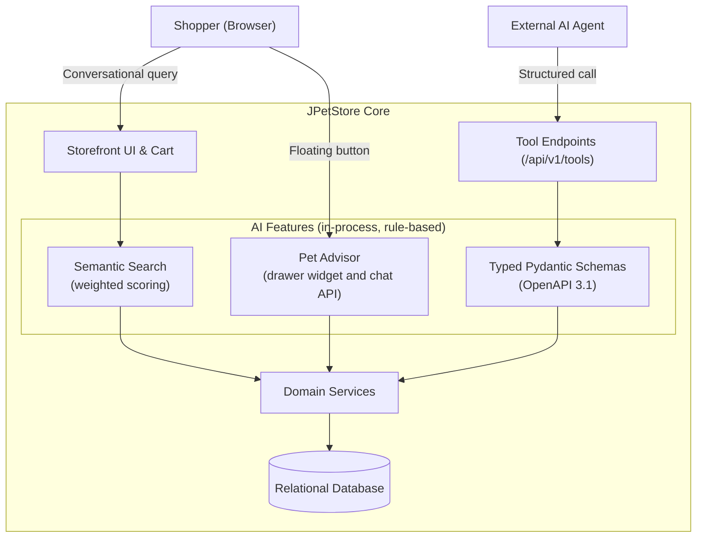

# JPetStore Modernized: AI-Native Python Architecture

[](https://www.python.org/downloads/)
[](https://fastapi.tiangolo.com/)
[](https://www.sqlalchemy.org/)
[](http://localhost:8080/docs)
[](.github/workflows/ci.yml)
[](.github/workflows/ci.yml)

---

## 1. Summary

This repository modernizes **MyBatis JPetStore 6** ([github.com/mybatis/jpetstore-6](https://github.com/mybatis/jpetstore-6)), a Java 11 / Spring MVC 5.3 / MyBatis 3 / HSQLDB application, into a Python 3.12+ application on FastAPI, SQLAlchemy 2.0 and Jinja2. It was built for the AI-Native Application Modernization Assessment (`docs/ASSESSMENT.pdf`). The client confirmed that the approach, preparation and presentation were at the candidate's discretion, including fixing identified vulnerabilities and adding AI capabilities.

Goals and what was done:

1. **Preserve business behavior and the look of the original.** The catalog (5 categories, 16 products, 28 items), image map, cart with Pet Favorites, multi-step checkout and order history are ported. The original CSS, markup structure and all 38 images are reused. Parity is claimed for the documented workflows, checked by regression tests and visual comparison with the original. Remaining differences are tracked in `docs/migration_issue_log.md`.
2. **Fix weaknesses in the legacy design.** Plaintext passwords are replaced with salted scrypt hashes (upgraded on first login), session state moves to signed client cookies, access control is centralized, and order data is restricted to its owner.
3. **Add a small AI layer with no external cost.** Semantic search, a cart-aware Pet Advisor and OpenAPI tool endpoints for external agents. These features are rule-based and make no LLM calls.
4. **Show the engineering approach.** Architecture decomposition, nine ADRs, a deviation log, verification gates, CI, and a prompt log tagged to milestones.

Other functionality: English and Japanese localization (gettext conventions, ISO 639-1 codes, `Accept-Language` negotiation) and a `/health` endpoint.

---

## 2. Assessment Areas and Evidence

| Assessment Area | What was done | Reference |
| :--- | :--- | :--- |
| **Architecture analysis** | Legacy controllers, services, mappers, data dictionary and checkout flow decomposed; risks identified. | `docs/jpetstore_architecture_decomposition.md` |
| **Context building** | The decomposition served as the baseline for each milestone; issues and corrections are logged. | `docs/jpetstore_architecture_decomposition.md`, `docs/migration_issue_log.md` |
| **Specification creation** | Scope per milestone and every intentional deviation from legacy behavior, with rationale. | `docs/jpetstore_migration_proposal_and_roadmap.md`, `docs/modernization_deviations_and_rationales.md` |
| **Architectural decisions** | Nine ADRs with options, decision and trade-offs. | `docs/architecture_decision_records.md` |
| **AI guardrails** | Verification gates (Ruff, Mypy, Bandit, Pytest), grounded outputs, typed schemas, atomic stock updates, central access control. | `docs/ai_guardrails_and_verification.md` |
| **CI/CD** | GitHub Actions: lint, type check, security scan, tests, Docker build. | `.github/workflows/ci.yml` |
| **Demonstration** | Eight-step script for the running application, with a Q&A sheet. | `docs/live_demonstration_guide.md` |
| **Tokenomics** | AI usage while building (pool percentages and prompt counts per milestone) and runtime cost design of the AI features. | `docs/tokenomics_telemetry_audit.md` |

A single index mapping each area to its artifact and how to verify it is in `docs/evidence_index.md`.

---

## 3. Legacy vs. Modernized Architecture

| Vector | Legacy (Java 11) | Modernized (Python) | Rationale |
| :--- | :--- | :--- | :--- |
| **Runtime** | Thread-per-request on Tomcat, blocking I/O | Async ASGI (FastAPI + Uvicorn), async connection pooling | Better I/O concurrency per worker. Not load tested. |
| **Session state** | Server-held `HttpSession` | Signed client cookies (`itsdangerous`, HMAC-SHA256) | No server-side session store, so any instance can serve any request. Cookies are signed, not encrypted, and limited to about 4 KB. |
| **Credentials** | Plaintext in `signon.password` | Salted scrypt (Python standard library), upgraded on first login | Removes plaintext storage. Argon2id was the original choice but its native build failed in the target environment (Issue 02, ADR-006). |
| **Data access** | MyBatis XML mappers with `#{}` bound parameters | SQLAlchemy 2.0 async, parameterized expressions | Parameterization is preserved. Adds typed queries and static analysis. |
| **Presentation** | JSP / JSTL | Jinja2 templates reusing the original DOM and CSS classes | Removes the servlet container dependency while keeping the original look. |
| **Catalog caching** | None | Bounded in-process LRU and TTL caches for static catalog data | Fewer repeated catalog queries. Stock and order sequence are never cached. Hit rate not measured. |
| **Search** | SQL `LIKE %keyword%` | In-process weighted semantic scoring and keyword matching | Handles conversational queries such as *"friendly dog for kids"*. No external calls. |
| **Machine integration** | HTML pages only | Web UI plus OpenAPI 3.1 tool endpoints | External agents can call store operations through typed contracts. |
| **Access control** | Per-controller session checks | Central dependency with database liveness check | Fewer omissions, no stale sessions, session fixation defense. |

---

## 4. System Topology

```
[ Web Browser ]                        [ External AI Agent ]
       │                                        │
       ▼ HTTP / HTML                            ▼ REST / JSON
┌───────────────────────────────────────────────────────────────────────┐
│ PRESENTATION & ROUTING                                                │
│  - Web routers (Jinja2, i18n context, signed-cookie session)          │
│  - Agent tools router (OpenAPI 3.1 contracts: /api/v1/tools)          │
│  - Central auth dependency (get_current_active_user)                  │
└───────────────────┬───────────────────────────────┬───────────────────┘
                    ▼                               ▼
┌───────────────────────────────────────────────────────────────────────┐
│ SERVICE LAYER                                                         │
│  - CatalogService   - CartService (Decimal math)                      │
│  - AccountService (scrypt hashing, upgrade on login)                  │
│  - OrderService (atomic checkout, conditional stock decrement)        │
│  - AIService (in-process semantic scoring, rule-based advisor)        │
└───────────────────┬───────────────────────────────────────────────────┘
                    ▼
┌───────────────────────────────────────────────────────────────────────┐
│ REPOSITORY LAYER                                                      │
│  - CatalogRepository (SearchCache, catalog caches)                    │
│  - AccountRepository   - OrderRepository (sequence, stock)            │
│  - SQLAlchemy 2.0 async engine and connection pool                    │
│  - SQLite (default) / PostgreSQL (by configuration)                   │
└───────────────────────────────────────────────────────────────────────┘
```

---

## 5. Architecture Decision Records

Full text, options and trade-offs are in `docs/architecture_decision_records.md`. Intentional deviations from legacy behavior are in `docs/modernization_deviations_and_rationales.md`.

| ADR | Decision |
| :--- | :--- |
| 001 | FastAPI on Uvicorn (ASGI) as the web framework |
| 002 | Port the legacy JSPs to Jinja2 and reuse the original CSS and images, instead of building a separate SPA |
| 003 | SQLAlchemy 2.0 (data mapper, unit of work) with repositories |
| 004 | Stateless signed session cookies instead of server-held sessions |
| 005 | Selective cache-aside for static catalog data. Stock and order sequence are never cached |
| 006 | Salted scrypt password hashing (amended from the original Argon2id choice) |
| 007 | Embedded AI capabilities: semantic search, agent tools, cart-aware advisor, all without external LLM calls |
| 008 | SQLite by default, PostgreSQL by configuration |
| 009 | Central access control and session hardening |

---

## 6. AI Capabilities

The AI features are rule-based and make no calls to an external LLM or embedding service. Matching is keyword and concept based, so unusual phrasing may match less well than a learned model. The scorer sits behind a service interface so a model-backed version could replace it.



### Semantic search
Lets shoppers search by lifestyle or temperament (for example *"friendly companion for small apartment"*) instead of exact names.

### Pet Advisor
A floating drawer on storefront pages:
* **Cart insights (`/advisor/cart_insights`):** suggests catalog items related to the cart contents and the signed-in user's favorite category, with one-click add to cart.
* **Care chat (`/advisor/chat`):** domain-bounded answers to feeding and habitat questions, with a polite fallback for off-topic input.

Recommendations come only from real catalog items. An early version surfaced items that were not in the catalog. This was fixed by grounding all recommendations in catalog item IDs.

### Agent tool endpoints (`/api/v1/tools`)
* **Swagger UI:** [http://localhost:8080/docs](http://localhost:8080/docs)
* **ReDoc:** [http://localhost:8080/redoc](http://localhost:8080/redoc)
* **OpenAPI JSON:** [http://localhost:8080/openapi.json](http://localhost:8080/openapi.json)

Endpoints:
* `GET /api/v1/tools/search_catalog`: intent-based product lookup.
* `GET /api/v1/tools/item/{item_id}`: SKU details, pricing and live stock.
* `GET /api/v1/tools/check_stock/{item_id}`: current stock for an item.
* `POST /api/v1/tools/calculate_order_quote`: subtotal, 7% sales tax and flat shipping, computed deterministically.
* `POST /api/v1/tools/pet_advisor`: care guidance and recommended accessories.

---

## 7. Guardrails and Verification

Details and limits are in `docs/ai_guardrails_and_verification.md`.

1. **Deterministic business logic.** Totals, tax and stock changes are computed in code with `Decimal` arithmetic, never by a model.
2. **Bounded input.** Search and chat input is stripped of control characters and limited to 200 characters. Because no LLM is called, there is no model prompt to inject into today. If one were added, injection screening, output validation and token limits would be required.
3. **Grounded output.** Advisor and tool responses are typed schemas built from catalog records.
4. **Parameterized queries.** Database access uses SQLAlchemy expressions. Bandit scans for unsafe constructs, and parameterization is enforced by using SQLAlchemy and by code review.
5. **Atomic stock updates.** `UPDATE inventory SET qty = qty - :qty WHERE itemid = :itemid AND qty >= :qty`. If stock is insufficient, `OutOfStockException` rolls back the transaction.
6. **Central access control.** Protected routes use `Depends(get_current_active_user)`, which re-checks the account in the database each request, clears the session on sign-in to prevent fixation, and returns a 303 redirect for web clients or 401 JSON for API clients.
7. **Order privacy.** Order views and order APIs are limited to the owning user, and card numbers are masked in API responses.

---

## 8. Tokenomics

Details are in `docs/tokenomics_telemetry_audit.md`.

**AI use while building (measured).** The IDE exposes quota only as a percentage of each model pool, not as token counts, so token and cost figures are not reported. Two readings were recorded on 28 Oct: the Gemini pool went from 89% to 80% weekly remaining and from 100% to 71% five-hour remaining, while the Claude and GPT pool was already exhausted. The build used 66 prompts across two sessions, tagged by milestone in the Prompt Log. 15 of them reported a defect or parity gap, which is the iteration evidence. The pool is account-wide, so the percentages are an upper bound for this project.

**Runtime cost design of the AI features (design analysis).** Search and the advisor run in-process with no external model calls, so they use no external tokens and have no external dependency. Latency and tool-schema token size were not benchmarked.

---

## 9. CI/CD and Tests

GitHub Actions (`.github/workflows/ci.yml`) runs on every push and pull request. Run results appear under the repository's Actions tab.

```
[ Push / PR ] ──► [ Python 3.12 ]
                        │
                        ├─► 1. Ruff (lint and format check)
                        ├─► 2. Mypy (static types across app/)
                        ├─► 3. Bandit (security scan)
                        ├─► 4. Pytest (regression suite)
                        └─► 5. Docker build
```

Test modules in `tests/`:
* `test_database.py`: schema creation and seed data ingestion.
* `test_catalog.py`: taxonomy, product resolution, search caching, live stock checks.
* `test_cart.py`: signed-cookie cart operations, quantity changes, decimal math.
* `test_account.py`: sign-in, scrypt hashing, upgrade of legacy plaintext credentials, registration, preferences.
* `test_order.py`: checkout, order ID sequence, atomic stock decrement, out-of-stock rollback.
* `test_tools_api.py`: agent tool endpoints and schemas.
* `test_ai_advisor.py`: semantic ranking and cross-sell rules.

---

## 10. Run and Verify

### Local run (port 8080)

```bash
python -m venv venv

# Linux/macOS
source venv/bin/activate
# Windows
.\venv\Scripts\activate

pip install -r requirements.txt
python run.py
```

* **Storefront:** [http://localhost:8080](http://localhost:8080)
* **Swagger UI:** [http://localhost:8080/docs](http://localhost:8080/docs)
* **ReDoc:** [http://localhost:8080/redoc](http://localhost:8080/redoc)
* **OpenAPI JSON:** [http://localhost:8080/openapi.json](http://localhost:8080/openapi.json)
* **Health check:** [http://localhost:8080/health](http://localhost:8080/health)
* **Seeded account:** `j2ee` / `j2ee` (the password is upgraded to a salted scrypt hash on first sign-in)

### Container (port 8000)

```bash
docker-compose up --build -d
docker-compose ps
docker-compose logs -f
```

* **Storefront:** [http://localhost:8000](http://localhost:8000)
* **Swagger UI:** [http://localhost:8000/docs](http://localhost:8000/docs)
* **Health check:** [http://localhost:8000/health](http://localhost:8000/health)

### Quality and security checks

```bash
pytest --cov=app --cov-report=term-missing tests/
ruff check .
ruff format --check .
mypy app/
bandit -r app/ -c pyproject.toml
```

---

## 11. Known Limitations

* Sessions are signed but not encrypted cookies, so contents are readable by the client and limited to about 4 KB. Only identifiers and cart references are stored.
* Search and the advisor are rule-based. Phrasing outside the scoring rules can return weaker results than a learned model.
* The default database is SQLite, and the automated tests run against SQLite. PostgreSQL is supported by changing the database URL and installing an async PostgreSQL driver.
* No load or latency benchmarking was performed. Scalability statements describe the design, not measured throughput.
* Until a seeded legacy account signs in for the first time, its seed password remains plaintext in the database.
* AI usage during the build is recorded as pool percentage and prompt counts, not tokens.

---

## 12. Documentation Index (`docs/`)

| Document | Contents |
| :--- | :--- |
| `docs/ASSESSMENT.pdf` | The assessment brief. |
| `docs/evidence_index.md` | Maps each assessment area to its evidence and how to verify it. |
| `docs/jpetstore_architecture_decomposition.md` | Legacy structure, components, data dictionary and checkout flow. |
| `docs/jpetstore_migration_proposal_and_roadmap.md` | Phased roadmap and definition of done. |
| `docs/architecture_decision_records.md` | ADR-001 through ADR-009. |
| `docs/modernization_deviations_and_rationales.md` | Each intentional deviation from legacy behavior, with rationale and trade-offs. |
| `docs/ai_guardrails_and_verification.md` | Guardrails, verification tooling and limits. |
| `docs/tokenomics_telemetry_audit.md` | AI usage during the build and runtime cost design. |
| `docs/live_demonstration_guide.md` | Step-by-step demonstration script and Q&A sheet. |
| `docs/migration_issue_log.md` | Issues encountered, root causes and resolutions. |
