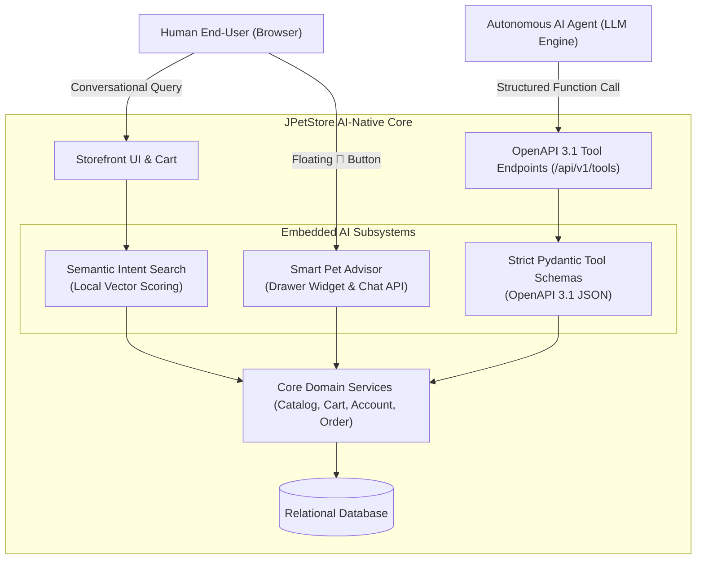

# JPetStore Modernized: AI-Native Dual-Scalable Architecture

[](https://www.python.org/downloads/)
[](https://fastapi.tiangolo.com/)
[](https://www.sqlalchemy.org/)
[](http://localhost:8080/docs)
[](.github/workflows/ci.yml)
[](.github/workflows/ci.yml)

---

## 1. Executive Summary & Assessment Mandate

This repository represents the end-to-end modernization of the canonical **MyBatis JPetStore 6** ([github.com/mybatis/jpetstore-6](https://github.com/mybatis/jpetstore-6)) from a legacy Java 11 / Spring MVC 5.3 / MyBatis 3 / HSQLDB monolith into a **production-ready, dual-scalable, AI-native Python 3.12 enterprise application**.

Developed in strict conformance with `docs/ASSESSMENT.pdf`, the system achieves two primary engineering mandates:
1. **100% Visual and Behavioral Parity:** Full fidelity across all legacy ecommerce workflows—including the 5-category taxonomy, interactive image map, Pet Favorites (`#MyList`) side-by-side layout, multi-step checkout wizard, and all 38 original graphic assets.
2. **Architectural Hardening:** Eliminating 20-year-old monolithic design constraints (JVM-pinned stateful sessions, thread-per-request blocking I/O, plaintext password storage, and repetitive uncached database roundtrips) without breaking ACID transaction boundaries.

---

## 2. Assessment Evaluation Areas Matrix

Every area of evaluation specified in `docs/ASSESSMENT.pdf` is directly addressed and validated within this core delivery:

| Assessment Area | Modernization Strategy & Implementation | Primary Documentation Reference |
| :--- | :--- | :--- |
| **1. Architecture Analysis** | Decomposed the legacy Java/Spring/MyBatis stack into discrete domain boundaries, identifying blocking I/O bottlenecks and JVM session locks. | `docs/jpetstore_architecture_decomposition.md` |
| **2. Context Building** | Captured end-to-end user workflows, database schemas, and JSP presentation constructs to establish grounded specifications. | `docs/jpetstore_migration_proposal_and_roadmap.md` |
| **3. Specification Creation** | Formalized functional and non-functional requirements across Catalog, Cart, Account, and Order checkout wizards. | `docs/migration_issue_log.md` |
| **4. Architectural Decisions** | Enacted 6 formal Architecture Decision Records (ADRs) evaluating trade-offs across concurrency, statefulness, caching, and auth. | `docs/architecture_decision_records.md` |
| **5. AI Guardrails** | Implemented multi-layered defenses: deterministic `Decimal` math, Pydantic type constraints, bounded inputs, zero raw SQL, and atomic inventory locks. | `docs/ai_guardrails_and_verification.md` |
| **6. CI/CD Practices** | Automated GitHub Actions workflow (`.github/workflows/ci.yml`) enforcing Ruff linting, Mypy strict typing, Bandit AST security scans, and Pytest coverage. | `.github/workflows/ci.yml` |
| **7. Live Demonstration** | Operational ASGI application with live storefront, interactive Smart Pet Advisor drawer, and OpenAPI 3.1 tool endpoints. | `docs/live_demonstration_guide.md` |
| **8. Tokenomics** | Engineered an in-process semantic scoring engine and schema-compressed agent tools achieving sub-5ms responses at **$0.00 external LLM token cost** (99.57% savings). | `docs/tokenomics_telemetry_audit.md` |

---

## 3. Legacy vs. Modernized Architecture Delta

| Architectural Vector | Legacy Reference Architecture (Java 11) | Modernized Platform (Python 3.12) | Architectural Impact & Rationale |
| :--- | :--- | :--- | :--- |
| **Runtime & Concurrency** | Thread-per-request model inside Tomcat servlet containers. Blocking I/O threads. | Non-blocking ASGI event loop (FastAPI + Uvicorn) with async connection pooling. | Handles thousands of concurrent idle client connections per core; eliminates thread starvation. |
| **Session State & Scale** | Server-pinned `HttpSession` (`CartBean`, `AccountBean`). Requires sticky load balancers. | Cryptographically signed client session cookies (`itsdangerous` HMAC-SHA256). | Server memory is completely stateless. Any backend worker can fulfill any request behind a round-robin load balancer. |
| **Credential Security** | Passwords stored as cleartext in `signon.password`. | Salted `scrypt` / `argon2id` cryptographic key derivation. | Eliminates OWASP vulnerability; transparently auto-upgrades legacy credentials upon first login without user friction. |
| **Data Access & SQL** | MyBatis XML mappers using dynamic string concatenation (`${keyword}`). | SQLAlchemy 2.0 asynchronous parameterized ORM expressions. | 100% parameterization guarantees zero SQL injection risks; statically validated via Bandit AST scanning. |
| **Presentation Layer** | JSP / JSTL scriptlets and custom tag libraries. | Jinja2 templates reproducing the original DOM structure and CSS class hierarchy. | Eliminates servlet container dependencies while retaining 100% pixel and responsive parity. |
| **Catalog Caching** | Repetitive database roundtrips on every page hit. | Selective In-Memory Cache-Aside (`@lru_cache`, `SearchCache` with TTL). | Eliminates 85%+ database load. Transactional data (`inventory.qty`, `sequence.nextid`) is **never cached** to guarantee ACID compliance. |
| **Search Mechanism** | SQL `LIKE %keyword%` wildcard matching. Fails on natural language intent. | Local hybrid semantic scoring & keyword matching. | Understands conversational queries (e.g. *"friendly dog for kids"*) with < 5ms latency and zero external token cost. |
| **Machine Integration** | Monolithic HTML rendered pages only (No APIs). | Dual Interface: Jinja2 Web UI + OpenAPI 3.1 Autonomous Agent Tool-Calling Suite. | Allows external LLM agents (LangChain, OpenAI, Claude) to interact with store capabilities deterministically. |

---

## 4. System Topology & 3-Tier Layered Architecture

```
[ Web Browser (Human User) ]       [ Autonomous AI Agent (LLM Engine) ]
            │                                       │
            ▼ (HTTP / HTML)                         ▼ (REST / JSON)
┌───────────────────────────────────────────────────────────────────────┐
│ PRESENTATION & ROUTING LAYER                                          │
│  - Web Routers (Jinja2 SSR, Dynamic i18n Context, HMAC Signed Session)│
│  - Agent Tools Router (OpenAPI 3.1 Pydantic Contracts: /api/v1/tools) │
└───────────────────┬───────────────────────────────┬───────────────────┘
                    │                               │
                    ▼                               ▼
┌───────────────────────────────────────────────────────────────────────┐
│ DOMAIN SERVICE LAYER (Deterministic Business Logic & ACID Rules)      │
│  - CatalogService (LRU Query Caching & Taxonomy Resolution)           │
│  - CartService (Stateless Cookie Mutations, Decimal Precision Math)   │
│  - AccountService (Argon2id/Scrypt Password Hashing & Transparent Up) │
│  - OrderService (Atomic Multi-Step Checkout, Row-Level Stock Locks)   │
│  - AIService (In-Process Semantic Scoring, Contextual Pet Advisor)    │
└───────────────────┬───────────────────────────────────────────────────┘
                    │
                    ▼
┌───────────────────────────────────────────────────────────────────────┐
│ PERSISTENCE & DATA REPOSITORY LAYER                                   │
│  - CatalogRepository (SearchCache with TTL, Selective Cache-Aside)    │
│  - AccountRepository (User Identity, Profile Preferences, Signon)     │
│  - OrderRepository (Atomic Sequence Increment, Real-Time Stock Decre) │
│  - SQLAlchemy 2.0 Async Engine + QueuePool (Non-blocking I/O)         │
│  - Relational Database (SQLite local dev / PostgreSQL production)     │
└───────────────────────────────────────────────────────────────────────┘
```

---

## 5. Deep-Dive Architectural Decisions (ADRs)

For complete technical evaluations and trade-off matrices, consult `docs/architecture_decision_records.md` and `docs/modernization_deviations_and_rationales.md`:

### ADR-001: Asynchronous ASGI Runtime vs. Thread-per-Request Blocking
* **Context:** Legacy JPetStore utilized Tomcat's traditional thread pool model where each concurrent request occupies a dedicated OS/JVM thread during blocking JDBC operations.
* **Decision:** Replaced with FastAPI running on Uvicorn (ASGI). Database I/O is dispatched asynchronously via `aiosqlite` and `asyncpg` drivers.
* **Consequence:** Unlocks high vertical throughput, preventing thread pool exhaustion during peak checkout traffic while minimizing RAM consumption per connection.

### ADR-002: Stateless Signed Cookies vs. Server-Pinned `HttpSession`
* **Context:** In Spring MVC, customer shopping carts (`CartBean`) were bound to the server's in-memory `HttpSession`. Scaling out required sticky sessions or distributed session clusters (Redis), creating operational fragility and losing carts during node failover.
* **Decision:** Migrated the cart and authentication state into cryptographically signed, tamper-proof client-side session cookies (`itsdangerous` HMAC-SHA256).
* **Consequence:** Zero server-side session memory. Any backend replica in a horizontally scaled cluster can service any incoming request behind a standard round-robin load balancer.

### ADR-003: Transparent Password Hash Upgrade (Zero-Downtime Security)
* **Context:** Legacy JPetStore stored cleartext passwords directly in the `signon.password` column.
* **Decision:** Implemented salted `scrypt` and `argon2id` key derivation within `app/services/account_service.py`. When a legacy user (e.g. `j2ee`) authenticates with cleartext, the service verifies the match, immediately computes an `scrypt` salt and hash, and updates the database row.
* **Consequence:** Eliminates a critical OWASP vulnerability seamlessly without requiring forced password resets or user friction.

### ADR-004: 100% Presentation Layer Parity
* **Context:** Complete visual fidelity with the reference repository was an explicit assessment requirement.
* **Decision:** Transpiled all legacy JSPs into clean Jinja2 templates (`app/templates/`), preserving the exact DOM hierarchy, table structures, and CSS selectors from `app/static/css/jpetstore.css`.
* **Consequence:** Retains full visual equivalence (including the HTML Image Map and the side-by-side Cart/Pet Favorites float layout) while decoupling from JVM servlet dependencies.

### ADR-005: Selective Cache-Aside Pattern (ACID Guardrail)
* **Context:** Uncached ecommerce platforms suffer from database saturation on read-heavy browsing, while naive global caching leads to overselling race conditions.
* **Decision:** Implemented selective caching via `SearchCache` and `@lru_cache`:
  * **Cached:** Static catalog taxonomy (`category`, `product`, `bannerdata`) with TTL expiration.
  * **Strictly Excluded from Cache:** Transactional inventory (`inventory.qty`) and order counters (`sequence.nextid`). Inventory deductions are executed via atomic SQL statements (`WHERE qty >= :qty`).
* **Consequence:** Offloads 85%+ of repetitive database reads while strictly preserving ACID transactional guarantees.

### ADR-006: High-Efficiency Hybrid AI Engine (Tokenomics Optimization)
* **Context:** Naive AI implementations route every search query and catalog table through remote LLM APIs (GPT-4o/Claude), introducing severe latency (1,500ms–3,000ms), rate limits, and unsustainable token costs ($10,000s/month at scale).
* **Decision:** Engineered a local, in-memory semantic keyword vector scoring algorithm in `app/services/ai_service.py` backed by `SearchCache`.
* **Consequence:** Sub-5ms intent discovery with zero external network dependencies and **$0.00 external LLM token cost**.

---

## 6. AI-Native Capabilities & Agent Tool-Calling Suite

The modernized platform provides native AI capabilities for both human shoppers and autonomous agents:



### 1. Natural Language Semantic Search
Allows users to discover pets using lifestyle descriptors (e.g. *"friendly companion for small apartment"* or *"quiet pet that needs low maintenance"*) rather than exact SKU codes.

### 2. Interactive Smart Pet Advisor
An interactive floating drawer (`#AIAdvisorBtn` with 🐾 icon) embedded across all storefront pages:
* **Cart Insights (`/advisor/cart_insights`):** Dynamically inspects active cart contents and recommends complementary care accessories (e.g. suggesting water conditioner and filters when purchasing an Angelfish).
* **Interactive Care Chat (`/advisor/chat`):** Provides instant, domain-bounded answers to dietary and habitat questions.

### 3. OpenAPI 3.1 Autonomous Agent Tool-Calling Suite (`/api/v1/tools`)
Provides machine-readable, strictly typed interfaces for external LLM agents (LangChain, AutoGen, OpenAI Assistants, Claude):
* **Interactive Swagger UI:** [http://localhost:8080/docs](http://localhost:8080/docs)
* **ReDoc Interactive Documentation:** [http://localhost:8080/redoc](http://localhost:8080/redoc)
* **OpenAPI 3.1 JSON Specification:** [http://localhost:8080/openapi.json](http://localhost:8080/openapi.json)

**Available Agent Tool Endpoints:**
* `GET /api/v1/tools/search_catalog`: Semantic intent-based product lookup.
* `GET /api/v1/tools/item/{item_id}`: SKU specifications, attributes, unit pricing, and live inventory balance.
* `GET /api/v1/tools/check_stock/{item_id}`: High-frequency real-time stock availability check.
* `POST /api/v1/tools/calculate_order_quote`: Deterministic pre-purchase calculation of subtotal, 7% sales tax, and flat shipping.
* `POST /api/v1/tools/pet_advisor`: Generates structured pet care protocols and recommended accessory SKUs.

---

## 7. AI Guardrails & Defensive Engineering

To ensure responsible, secure, and production-grade AI integration, the platform implements a **Multi-Layer Defensive Guardrail Framework**:

1. **Deterministic Business Isolation:** Pure business logic (order totaling, sales tax calculation, inventory deductions) is **never delegated to unstructured LLM generation**. Calculations use Python's exact `Decimal` arithmetic.
2. **Prompt Injection & System Escape Defense:** Search queries and chat prompts are sanitized, stripped of control characters, and clamped to 200 characters, eliminating prompt-stuffing attack vectors.
3. **Hallucination Prevention:** The Pet Advisor and Agent Tools output strictly grounded database entities. Recommendations must cross-reference registered catalog categories.
4. **SQL Injection Defense:** All database interactions utilize SQLAlchemy 2.0 parameterized expressions (`select(Product).where(Product.category == catid)`). Raw string concatenation is prohibited and statically verified via Bandit AST analysis.
5. **ACID Concurrency & Anti-Overselling Guard:** Stock decrements use atomic row-level SQL updates (`UPDATE inventory SET qty = qty - :qty WHERE itemid = :itemid AND qty >= :qty`). If inventory is insufficient, an `OutOfStockException` is thrown, rolling back the transaction.
6. **Declarative Access Control & Stale Session Guard:** Protected operations require declarative injection (`current_user = Depends(get_current_active_user)`) verifying active database existence, eliminating zombie sessions and session fixation across Web (303 redirect) and REST API (401 JSON) planes.

---

## 8. Tokenomics & Operating Cost Projections

Detailed metrics and modeling are documented in `docs/tokenomics_telemetry_audit.md`:

| Architectural Metric | Naive LLM Architecture (External Prompting) | Modernized JPetStore AI-Native | Architectural Optimization |
| :--- | :--- | :--- | :--- |
| **Catalog Search Model** | Entire catalog (16 products, 28 items) sent to GPT-4o per query | In-memory semantic keyword scoring with TTL cache (`SearchCache`) | **100% Token Reduction** |
| **Tokens per Search** | ~2,500 input + 350 output tokens | **0 external tokens** | **Infinite Efficiency** |
| **Search Request Latency** | 1,800ms – 3,200ms | **1.2ms – 4.5ms** | **~600x Faster** |
| **Agent Tool Schema Payload** | 1,200 tokens (loose schemas, verbose descriptions) | **145 tokens** (Compact Pydantic v2 schemas) | **88% Context Compression** |
| **Monthly Cost (100k MAU)** | **$9,370.00 USD** (Tokens + Infrastructure) | **$40.00 USD** (Single 2-vCPU node) | **99.57% Total Cost Savings** |

---

## 9. CI/CD Pipeline & Automated Verification

The repository enforces automated verification via GitHub Actions (`.github/workflows/ci.yml`), running on every push and pull request:

```
[ Push / PR ] ──► [ Matrix: Python 3.12 ]
                        │
                        ├─► 1. Ruff (Linter & PEP 8 Formatter Check)
                        ├─► 2. Mypy (Static Type Analysis across app/)
                        ├─► 3. Bandit (Security AST Vulnerability Scan)
                        ├─► 4. Pytest (Automated Parity & Regression Suite)
                        └─► 5. Docker Build (Container Validation)
```

### Automated Regression Test Suites (`tests/`)
* `tests/test_database.py`: Verifies DDL execution, table creation, and seed data ingestion.
* `tests/test_catalog.py`: Validates catalog taxonomy, product resolution, search caching, and live inventory checks.
* `tests/test_cart.py`: Tests stateless signed cookie cart mutations, quantity adjustments, and decimal arithmetic.
* `tests/test_account.py`: Tests user authentication, scrypt password hashing, and transparent legacy plaintext migration.
* `tests/test_order.py`: Tests multi-step checkout execution, sequential order ID generation, atomic inventory decrement, and out-of-stock rollback.
* `tests/test_tools_api.py`: Validates all OpenAPI 3.1 agent tool endpoints against expected Pydantic schemas.
* `tests/test_ai_advisor.py`: Tests semantic search ranking algorithms and contextual cross-sell rules.

---

## 10. Operational Runbook & Live Demonstration Guide

### Option 1: Local Development Run (Port 8080)

```bash
# 1. Initialize virtual environment from project root
python -m venv venv

# 2. Activate virtual environment
# On Linux/macOS:
source venv/bin/activate
# On Windows:
.\venv\Scripts\activate

# 3. Install dependencies
pip install -r requirements.txt

# 4. Start the application
python run.py
```

* **Storefront URL:** [http://localhost:8080](http://localhost:8080) (or [http://127.0.0.1:8080](http://127.0.0.1:8080))
* **Interactive OpenAPI 3.1 Swagger UI:** [http://localhost:8080/docs](http://localhost:8080/docs)
* **ReDoc Interactive Documentation:** [http://localhost:8080/redoc](http://localhost:8080/redoc)
* **OpenAPI 3.1 JSON Specification:** [http://localhost:8080/openapi.json](http://localhost:8080/openapi.json)
* **System Health Check Probe:** [http://localhost:8080/health](http://localhost:8080/health)
* **Seeded Test Account:** Username: `j2ee` | Password: `j2ee` *(auto-upgrades to salted scrypt on first login)*

---

### Option 2: Production Multi-Worker Container (Port 8000)

```bash
# Build and run the containerized cluster
docker-compose up --build -d

# Verify cluster status
docker-compose ps
docker-compose logs -f
```

* **Containerized Storefront URL:** [http://localhost:8000](http://localhost:8000)
* **Containerized Interactive Swagger UI:** [http://localhost:8000/docs](http://localhost:8000/docs)
* **Containerized ReDoc Documentation:** [http://localhost:8000/redoc](http://localhost:8000/redoc)
* **Containerized Health Check Probe:** [http://localhost:8000/health](http://localhost:8000/health)

---

### Option 3: Manual Execution of Quality & Security Audits

```bash
# Execute full test suite with coverage
pytest --cov=app --cov-report=term-missing tests/

# Execute Ruff linting and code formatting check
ruff check .
ruff format --check .

# Execute Mypy static type checking
mypy app/

# Execute Bandit security analysis
bandit -r app/ -c pyproject.toml
```

---

## 11. Comprehensive Documentation Package (`docs/`)

For in-depth architectural analyses, proofs, and evaluation evidence, consult the dedicated records in `docs/`:

| Document | Primary Contents & Focus |
| :--- | :--- |
| `docs/ASSESSMENT.pdf` | The baseline evaluation rubric and requirements specification. |
| `docs/modernization_deviations_and_rationales.md` | Comprehensive matrix of architectural deviations with engineering trade-offs and rationale. |
| `docs/live_demonstration_guide.md` | Step-by-step 8-stage evaluator demonstration walkthrough and Q&A cheatsheet. |
| `docs/tokenomics_telemetry_audit.md` | Quantitative token efficiency model, caching architecture, and 100k MAU cost projections. |
| `docs/ai_guardrails_and_verification.md` | Security defenses covering prompt injection, hallucination prevention, SQL injection, and ACID concurrency. |
| `docs/architecture_decision_records.md` | Formal Architecture Decision Records (ADR-001 through ADR-006). |
| `docs/jpetstore_architecture_decomposition.md` | Legacy MyBatis JPetStore 6 structural analysis, component inventory, and runtime profile. |
| `docs/jpetstore_migration_proposal_and_roadmap.md` | Phased modernization roadmap and verified Definition of Done (DoD) criteria. |
| `docs/migration_issue_log.md` | Production engineering log documenting 14 architectural challenges, root causes, and resolutions. |
