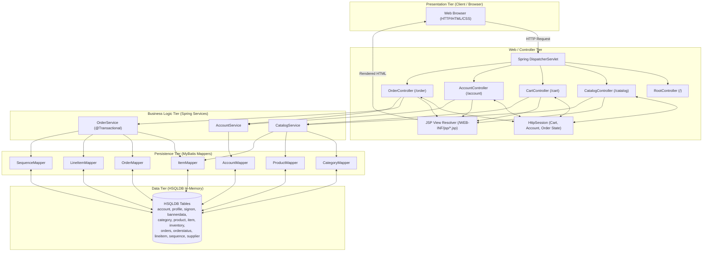
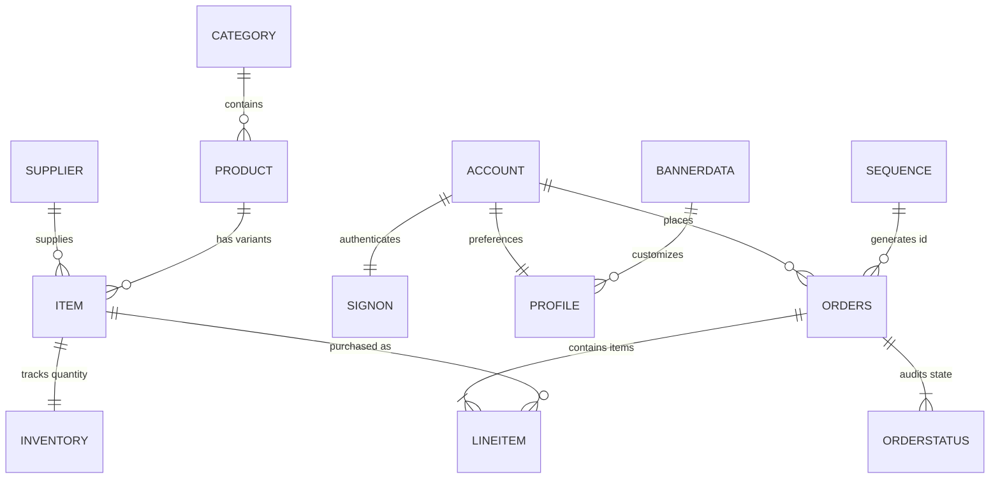
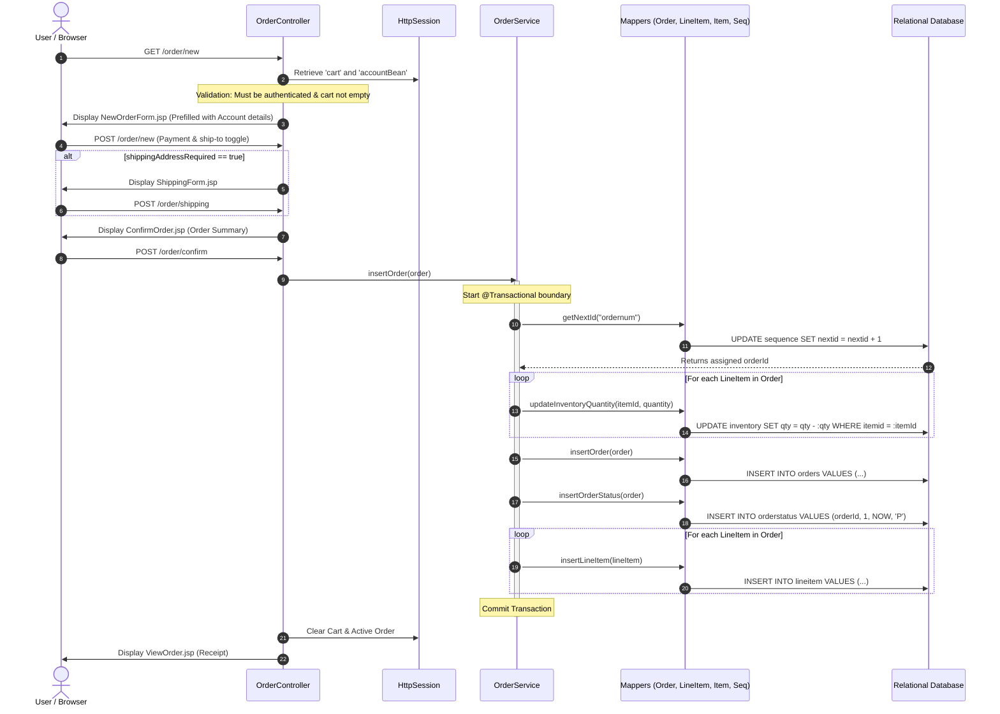
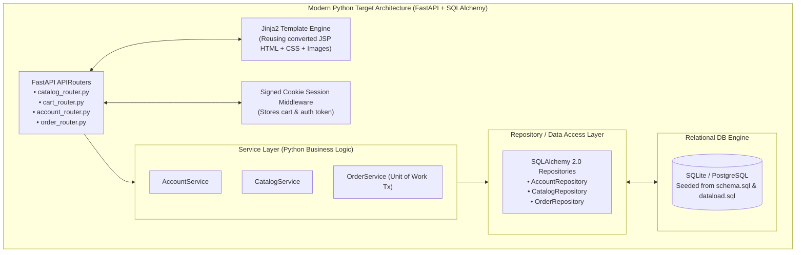

# JPetStore 6: Application Architecture Decomposition Document

## 1. Executive Summary & Assessment Context
This document establishes the formal architectural decomposition of the **MyBatis JPetStore 6** application to serve as the baseline specification for modernizing the system into an AI-native Python-based application, in accordance with the evaluation requirements in [ASSESSMENT.pdf](file:///c:/Angappan/SourceCode/TalentGigs/jpetstore-6/ASSESSMENT.pdf).

JPetStore is an e-commerce reference application modeling an online pet store. Its core capabilities include:
* Hierarchical product catalog browsing (Categories -> Products -> Items) and full-text keyword search.
* In-session shopping cart with dynamic price aggregation and inventory availability checks.
* User authentication, account registration, contact information, and customizable profile preferences (favorite categories, banner ads, and customized lists).
* Transactional multi-step checkout workflow with sequence-based order ID generation, atomic inventory deduction, and historical order tracking.

---

## 2. Legacy Technology Stack Breakdown

| Layer | Legacy Implementation | Configuration / Source Files |
| :--- | :--- | :--- |
| **Runtime & Platform** | Java 11 / Java 17, Servlet 4.0 / Tomcat 9 | [pom.xml](file:///c:/Angappan/SourceCode/TalentGigs/jpetstore-6/pom.xml), [Dockerfile](file:///c:/Angappan/SourceCode/TalentGigs/jpetstore-6/Dockerfile) |
| **Dependency Injection & Tx** | Spring Framework 5.3 (`spring-webmvc`, `spring-jdbc`, `spring-tx`) | [applicationContext.xml](file:///c:/Angappan/SourceCode/TalentGigs/jpetstore-6/src/main/webapp/WEB-INF/applicationContext.xml) |
| **Web MVC Framework** | Spring MVC (`DispatcherServlet`, `@Controller`, `@GetMapping`, `@PostMapping`) | [spring-mvc.xml](file:///c:/Angappan/SourceCode/TalentGigs/jpetstore-6/src/main/webapp/WEB-INF/spring-mvc.xml), [web.xml](file:///c:/Angappan/SourceCode/TalentGigs/jpetstore-6/src/main/webapp/WEB-INF/web.xml) |
| **Persistence / ORM** | MyBatis 3 (`mybatis-spring`) with XML Mapper definitions | [org/mybatis/jpetstore/mapper/](file:///c:/Angappan/SourceCode/TalentGigs/jpetstore-6/src/main/resources/org/mybatis/jpetstore/mapper/) |
| **Database Engine** | HSQLDB 2.7 (Embedded In-Memory Relational Engine) | [jpetstore-hsqldb-schema.sql](file:///c:/Angappan/SourceCode/TalentGigs/jpetstore-6/src/main/resources/database/jpetstore-hsqldb-schema.sql) |
| **View / Presentation** | JSP 2.3 + JSTL (`c:`, `fmt:`) + Custom CSS | [src/main/webapp/WEB-INF/jsp/](file:///c:/Angappan/SourceCode/TalentGigs/jpetstore-6/src/main/webapp/WEB-INF/jsp/), [jpetstore.css](file:///c:/Angappan/SourceCode/TalentGigs/jpetstore-6/src/main/webapp/css/jpetstore.css) |
| **Session Management** | Servlet `HttpSession` (in-memory state for Cart and Account) | [AccountController.java](file:///c:/Angappan/SourceCode/TalentGigs/jpetstore-6/src/main/java/org/mybatis/jpetstore/web/controllers/AccountController.java), [CartController.java](file:///c:/Angappan/SourceCode/TalentGigs/jpetstore-6/src/main/java/org/mybatis/jpetstore/web/controllers/CartController.java) |

---

## 3. Structural Topology & Architectural Layers

---

## 4. Component-by-Component Decomposition

### 4.1. Web Layer (`org.mybatis.jpetstore.web.controllers`)

| Component | Responsibility | Endpoints & Methods | Dependencies |
| :--- | :--- | :--- | :--- |
| [RootController](file:///c:/Angappan/SourceCode/TalentGigs/jpetstore-6/src/main/java/org/mybatis/jpetstore/web/controllers/RootController.java) | Entrypoint router | `GET /` ➔ Redirects to `/catalog` | None |
| [CatalogController](file:///c:/Angappan/SourceCode/TalentGigs/jpetstore-6/src/main/java/org/mybatis/jpetstore/web/controllers/CatalogController.java) | Catalog browsing & search | `GET /catalog` (Main Menu) `GET /catalog/categories/{categoryId}` `GET /catalog/products/{productId}` `GET /catalog/items/{itemId}` `POST /catalog/search` | [CatalogService](file:///c:/Angappan/SourceCode/TalentGigs/jpetstore-6/src/main/java/org/mybatis/jpetstore/service/CatalogService.java) |
| [CartController](file:///c:/Angappan/SourceCode/TalentGigs/jpetstore-6/src/main/java/org/mybatis/jpetstore/web/controllers/CartController.java) | In-memory shopping cart operations | `GET /cart` (View cart) `GET /cart/addItem?workingItemId={id}` `GET /cart/removeItem?workingItemId={id}` `POST /cart/update` (Bulk quantity updates) | [CatalogService](file:///c:/Angappan/SourceCode/TalentGigs/jpetstore-6/src/main/java/org/mybatis/jpetstore/service/CatalogService.java), `HttpSession` |
| [AccountController](file:///c:/Angappan/SourceCode/TalentGigs/jpetstore-6/src/main/java/org/mybatis/jpetstore/web/controllers/AccountController.java) | User lifecycle, auth, and preferences | `GET/POST /account` (Sign-in form & submit) `GET /account/signoff` `GET/POST /account/new` (Registration form & submit) `GET/POST /account/edit` (Profile update form & submit) | [AccountService](file:///c:/Angappan/SourceCode/TalentGigs/jpetstore-6/src/main/java/org/mybatis/jpetstore/service/AccountService.java), [CatalogService](file:///c:/Angappan/SourceCode/TalentGigs/jpetstore-6/src/main/java/org/mybatis/jpetstore/service/CatalogService.java), `HttpSession` |
| [OrderController](file:///c:/Angappan/SourceCode/TalentGigs/jpetstore-6/src/main/java/org/mybatis/jpetstore/web/controllers/OrderController.java) | Checkout wizard & order history | `GET /order/list` (Historical orders) `GET /order/new` (Initialize checkout from cart) `POST /order/new` (Submit payment/billing info) `POST /order/shipping` (Submit custom shipping address) `GET/POST /order/confirm` (Final review & execution) `GET /order/view?orderId={id}` | [OrderService](file:///c:/Angappan/SourceCode/TalentGigs/jpetstore-6/src/main/java/org/mybatis/jpetstore/service/OrderService.java), `HttpSession` |

---

### 4.2. Business Service Layer (`org.mybatis.jpetstore.service`)

#### [AccountService](file:///c:/Angappan/SourceCode/TalentGigs/jpetstore-6/src/main/java/org/mybatis/jpetstore/service/AccountService.java)
* **`getAccount(String username)`**: Retrieves consolidated account, profile, and banner preferences for a user.
* **`getAccount(String username, String password)`**: Validates credentials against `signon` table.
* **`insertAccount(Account account)`** (`@Transactional`): Writes to 3 tables: `account`, `profile`, and `signon`.
* **`updateAccount(Account account)`** (`@Transactional`): Updates `account` demographics, `profile` preferences, and optionally updates password in `signon` if a non-empty string is provided.

#### [CatalogService](file:///c:/Angappan/SourceCode/TalentGigs/jpetstore-6/src/main/java/org/mybatis/jpetstore/service/CatalogService.java)
* **`getCategoryList()`**: Returns all active categories (`FISH`, `DOGS`, `REPTILES`, `CATS`, `BIRDS`).
* **`getCategory(String categoryId)`**: Returns category metadata.
* **`getProductListByCategory(String categoryId)`**: Retrieves all products linked to a category.
* **`getProduct(String productId)`**: Retrieves single product info.
* **`searchProductList(String keywords)`**: Splits whitespace-delimited tokens, wraps each token in `%token%`, and performs case-insensitive wildcard searches against product names and categories.
* **`getItemListByProduct(String productId)`**: Retrieves all stockable item variations (SKUs) for a product.
* **`getItem(String itemId)`**: Retrieves SKU details along with supplier metadata and current inventory quantity.
* **`isItemInStock(String itemId)`**: Queries `inventory.qty > 0`.

#### [OrderService](file:///c:/Angappan/SourceCode/TalentGigs/jpetstore-6/src/main/java/org/mybatis/jpetstore/service/OrderService.java)
* **`insertOrder(Order order)`** (`@Transactional`):
  1. Calls `getNextId("ordernum")` to fetch and increment sequence atomically.
  2. For every line item, runs `itemMapper.updateInventoryQuantity({itemId, increment})` decrementing stock (`qty = qty - increment`).
  3. Inserts master row into `orders`.
  4. Inserts initial status record into `orderstatus` (`status = 'P'` for Pending).
  5. Inserts each `lineitem` with auto-incremented `linenum` and captured `unitprice`.
* **`getOrder(int orderId)`** (`@Transactional`): Loads `orders`, joins line items, and attaches current item descriptions and stock levels.
* **`getOrdersByUsername(String username)`**: Retrieves order history for a customer ordered by date.
* **`getNextId(String name)`**: Queries `sequence` table by key name, updates `nextid = nextid + 1`, and returns the incremented ID.

---

### 4.3. Persistence Layer (`org.mybatis.jpetstore.mapper`)

| Mapper Interface | XML Descriptor | Operations |
| :--- | :--- | :--- |
| [AccountMapper](file:///c:/Angappan/SourceCode/TalentGigs/jpetstore-6/src/main/java/org/mybatis/jpetstore/mapper/AccountMapper.java) | [AccountMapper.xml](file:///c:/Angappan/SourceCode/TalentGigs/jpetstore-6/src/main/resources/org/mybatis/jpetstore/mapper/AccountMapper.xml) | `getAccountByUsername`, `getAccountByUsernameAndPassword`, `insertAccount`, `insertProfile`, `insertSignon`, `updateAccount`, `updateProfile`, `updateSignon` |
| [CategoryMapper](file:///c:/Angappan/SourceCode/TalentGigs/jpetstore-6/src/main/java/org/mybatis/jpetstore/mapper/CategoryMapper.java) | [CategoryMapper.xml](file:///c:/Angappan/SourceCode/TalentGigs/jpetstore-6/src/main/resources/org/mybatis/jpetstore/mapper/CategoryMapper.xml) | `getCategoryList`, `getCategory` |
| [ProductMapper](file:///c:/Angappan/SourceCode/TalentGigs/jpetstore-6/src/main/java/org/mybatis/jpetstore/mapper/ProductMapper.java) | [ProductMapper.xml](file:///c:/Angappan/SourceCode/TalentGigs/jpetstore-6/src/main/resources/org/mybatis/jpetstore/mapper/ProductMapper.xml) | `getProductListByCategory`, `getProduct`, `searchProductList` |
| [ItemMapper](file:///c:/Angappan/SourceCode/TalentGigs/jpetstore-6/src/main/java/org/mybatis/jpetstore/mapper/ItemMapper.java) | [ItemMapper.xml](file:///c:/Angappan/SourceCode/TalentGigs/jpetstore-6/src/main/resources/org/mybatis/jpetstore/mapper/ItemMapper.xml) | `getItemListByProduct`, `getItem`, `getInventoryQuantity`, `updateInventoryQuantity` |
| [OrderMapper](file:///c:/Angappan/SourceCode/TalentGigs/jpetstore-6/src/main/java/org/mybatis/jpetstore/mapper/OrderMapper.java) | [OrderMapper.xml](file:///c:/Angappan/SourceCode/TalentGigs/jpetstore-6/src/main/resources/org/mybatis/jpetstore/mapper/OrderMapper.xml) | `getOrder`, `getOrdersByUsername`, `insertOrder`, `insertOrderStatus` |
| [LineItemMapper](file:///c:/Angappan/SourceCode/TalentGigs/jpetstore-6/src/main/java/org/mybatis/jpetstore/mapper/LineItemMapper.java) | [LineItemMapper.xml](file:///c:/Angappan/SourceCode/TalentGigs/jpetstore-6/src/main/resources/org/mybatis/jpetstore/mapper/LineItemMapper.xml) | `getLineItemsByOrderId`, `insertLineItem` |
| [SequenceMapper](file:///c:/Angappan/SourceCode/TalentGigs/jpetstore-6/src/main/java/org/mybatis/jpetstore/mapper/SequenceMapper.java) | [SequenceMapper.xml](file:///c:/Angappan/SourceCode/TalentGigs/jpetstore-6/src/main/resources/org/mybatis/jpetstore/mapper/SequenceMapper.xml) | `getSequence`, `updateSequence` |

---

## 5. Domain Models & Relational Data Dictionary

### 5.1. Catalog & Inventory Tables
1. **`category`**:
   * `catid` (VARCHAR 10, PK): Unique code (`FISH`, `DOGS`, `REPTILES`, `CATS`, `BIRDS`).
   * `name` (VARCHAR 80): Display name.
   * `descn` (VARCHAR 255): HTML markup containing category icon image tag and title.
2. **`product`**:
   * `productid` (VARCHAR 10, PK): e.g. `FI-SW-01`.
   * `category` (VARCHAR 10, FK -> `category.catid`): Parent category.
   * `name` (VARCHAR 80): Product title (e.g. `Angelfish`).
   * `descn` (VARCHAR 255): HTML snippet with image thumbnail and textual description.
3. **`item`**:
   * `itemid` (VARCHAR 10, PK): Specific SKU code (e.g. `EST-1`).
   * `productid` (VARCHAR 10, FK -> `product.productid`): Parent product.
   * `listprice` (DECIMAL 10,2): Retail sale price.
   * `unitcost` (DECIMAL 10,2): Wholesale/acquisition cost.
   * `supplier` (INT, FK -> `supplier.suppid`): Origin supplier ID.
   * `status` (VARCHAR 2): Stock status indicator (`P` = Available).
   * `attr1` - `attr5` (VARCHAR 80): Variation descriptors (e.g. size `Large`, gender `Male`).
4. **`inventory`**:
   * `itemid` (VARCHAR 10, PK, FK -> `item.itemid`): Item reference.
   * `qty` (INT): Available quantity in stock (decremented upon order completion).
5. **`supplier`**:
   * `suppid` (INT, PK), `name` (VARCHAR 80), `status` (VARCHAR 2), `addr1`, `addr2`, `city`, `state`, `zip`, `phone`.

### 5.2. Customer & Authentication Tables
1. **`signon`**:
   * `username` (VARCHAR 25, PK): User login identifier.
   * `password` (VARCHAR 25): Plaintext password (security enhancement target for Python modernization).
2. **`account`**:
   * `userid` (VARCHAR 80, PK): Linked to username.
   * `email`, `firstname`, `lastname`, `status`, `addr1`, `addr2`, `city`, `state`, `zip`, `country`, `phone`.
3. **`profile`**:
   * `userid` (VARCHAR 80, PK, FK -> `account.userid`): User identifier.
   * `langpref` (VARCHAR 80): Language preference (`english`, `japanese`).
   * `favcategory` (VARCHAR 30, FK -> `category.catid`): Customer's primary interest category.
   * `mylistopt` (INT): Boolean toggle (1 = enable personalized category quicklist in cart).
   * `banneropt` (INT): Boolean toggle (1 = enable category banner rendering on top bar).
4. **`bannerdata`**:
   * `favcategory` (VARCHAR 80, PK): Category key.
   * `bannername` (VARCHAR 255): HTML image tag for top advertising banner.

### 5.3. Ordering & Fulfillment Tables
1. **`orders`**:
   * `orderid` (INT, PK): Sequential ID provided by `sequence`.
   * `userid` (VARCHAR 80, FK -> `account.userid`): Customer identifier.
   * `orderdate` (DATE): Timestamp when order was placed.
   * `shipaddr1`, `shipaddr2`, `shipcity`, `shipstate`, `shipzip`, `shipcountry`: Shipping address.
   * `billaddr1`, `billaddr2`, `billcity`, `billstate`, `billzip`, `billcountry`: Billing address.
   * `courier` (VARCHAR 80): Selected carrier (e.g. `UPS`, `FedEx`).
   * `totalprice` (DECIMAL 10,2): Aggregate order cost.
   * `billtofirstname`, `billtolastname`, `shiptofirstname`, `shiptolastname`: Recipient and payor names.
   * `creditcard` (VARCHAR 80), `exprdate` (VARCHAR 7), `cardtype` (VARCHAR 80): Payment details.
   * `locale` (VARCHAR 80): Browser locale.
2. **`orderstatus`**:
   * `orderid` (INT, PK, FK -> `orders.orderid`): Associated order.
   * `linenum` (INT, PK): Line sequence number.
   * `timestamp` (DATE): Status change date.
   * `status` (VARCHAR 2): Fulfillment status code (`P` = Pending).
3. **`lineitem`**:
   * `orderid` (INT, PK, FK -> `orders.orderid`): Associated order.
   * `linenum` (INT, PK): Index position within order.
   * `itemid` (VARCHAR 10, FK -> `item.itemid`): Item SKU.
   * `quantity` (INT): Units purchased.
   * `unitprice` (DECIMAL 10,2): Price at time of transaction.
4. **`sequence`**:
   * `name` (VARCHAR 30, PK): Identifier name (`ordernum`).
   * `nextid` (INT): Current counter value (seeded at 1000).

---

## 6. Business Workflow & State Decomposition

### 6.1. Shopping Cart Lifecycle ([Cart.java](file:///c:/Angappan/SourceCode/TalentGigs/jpetstore-6/src/main/java/org/mybatis/jpetstore/domain/Cart.java))
* **Storage:** Cart lives in the user's session (`session.getAttribute("cart")`). Unauthenticated guests have an active cart.
* **Data Structure:** Maintained as a `ConcurrentHashMap<String, CartItem>` for $O(1)$ lookups and a synchronized `ArrayList<CartItem>` for ordered rendering.
* **Subtotal Calculation:** Functional stream reducing line item costs:
  $$\text{SubTotal} = \sum (\text{item.listPrice} \times \text{quantity})$$
* **Cart Actions:**
  * `addItem`: If item already exists, quantity is incremented by 1; otherwise, creates new `CartItem` checking stock via `CatalogService.isItemInStock()`.
  * `removeItem`: Removes SKU from both hash map and list.
  * `update`: Accepts form post containing key-value pairs of `{itemId: quantity}`. If quantity $< 1$, the item is removed.

### 6.2. Transactional Checkout & Order Lifecycle ([OrderService.java](file:///c:/Angappan/SourceCode/TalentGigs/jpetstore-6/src/main/java/org/mybatis/jpetstore/service/OrderService.java))

---

## 7. Security, State, and Quality Analysis

### Current Technical Debt & Risks in Legacy Code
1. **Authentication & Password Storage:**
   * Passwords in table `signon` are stored as **plaintext strings** without salt or hashing (e.g., `'j2ee'`, `'ACID'`).
   * Modernization must introduce **Argon2id** or **bcrypt** password hashing.
2. **Session Hijacking & State Leakage:**
   * `HttpSession` stores mutable domain objects directly in memory without tamper protection or encryption.
   * Modernization should adopt cryptographically signed HTTP session cookies (`itsdangerous` / Starlette `SessionMiddleware`) or Redis-backed sessions.
3. **Database Concurrency in Sequence Generation:**
   * `sequence` table generation uses an explicit select-then-update or update pattern. In Python/PostgreSQL/SQLite, this should leverage native database `AUTOINCREMENT` / `SERIAL` sequences or atomic row-locking (`SELECT ... FOR UPDATE`).
4. **SQL Injection Guard:**
   * MyBatis XML uses parameterized `#` substitutions (`#{productId}`), preventing SQL injection. Python target must enforce **parameterized queries via SQLAlchemy ORM / Core**.

---

## 8. Target Python Architecture Mapping

To fulfill the modernization criteria while maintaining architectural purity and 100% functional parity:

### Component Mapping Matrix

| Legacy Java Component | Modern Python Component | File Path Proposal |
| :--- | :--- | :--- |
| `org.mybatis.jpetstore.domain.*` | Pydantic Schemas + SQLAlchemy ORM Models | `app/models/` & `app/schemas/` |
| `org.mybatis.jpetstore.mapper.*` | SQLAlchemy 2.0 Repositories | `app/repositories/` |
| `org.mybatis.jpetstore.service.*` | Python Service Classes | `app/services/` |
| `org.mybatis.jpetstore.web.controllers.*` | FastAPI APIRouters | `app/routers/` |
| `src/main/webapp/WEB-INF/jsp/` | Jinja2 Templates | `app/templates/` |
| `src/main/webapp/css/` & `images/` | Static Asset Directory | `app/static/` |
| `jpetstore-hsqldb-schema.sql` | Standard SQL DDL (SQLite/Postgres compatible) | `app/database/schema.sql` |
| `jpetstore-hsqldb-dataload.sql` | Seed Script | `app/database/seed_data.sql` |
