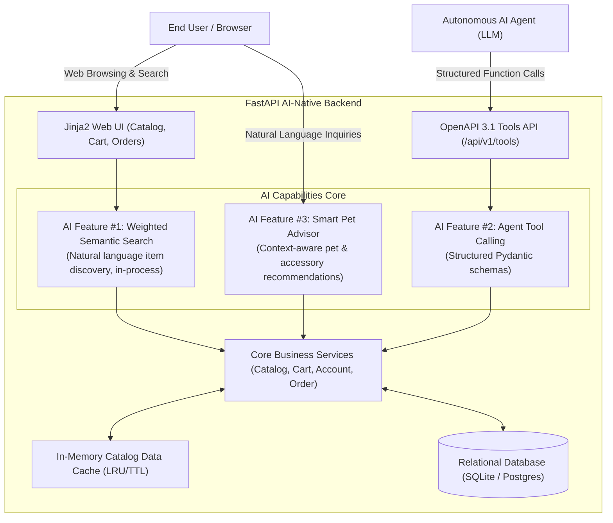

# JPetStore Modernization: AI-Native Migration Proposal & Strategic Roadmap

**Document Version:** 1.2.0  
**Role:** AI Technical Lead  
**Target Platform:** Python 3.12+ (FastAPI, SQLAlchemy 2.0, Pydantic v2, Jinja2, Uvicorn)  
**Baseline Reference:** docs/jpetstore_architecture_decomposition.md  
**Evaluation Standard:** docs/ASSESSMENT.pdf  

---

## 1. Executive Summary & Strategic Decisions

This proposal defines the engineering methodology and phased roadmap for modernizing the legacy **MyBatis JPetStore 6** (Java 11, Spring MVC 5.3, MyBatis 3, HSQLDB) into an **AI-Native, Dual-Scalable Python Enterprise Application**.

The client confirmed that the approach, preparation and presentation are at the candidate's discretion, including fixing identified vulnerabilities and adding AI capabilities. The decisions below are made on that basis.

### Key Architectural Decisions Confirmed:
1. **Frontend Continuity (Visual & Workflow Parity):**
   * Reuse the existing frontend presentation layer by converting legacy JSPs into **Jinja2 templates**.
   * Retain all 38 graphic assets (app/static/images/), app/static/css/jpetstore.css, and navigation hierarchies.
2. **Dual Scalability (Vertical & Horizontal):**
   * **Horizontal Scale-Out:** Completely eliminate JVM in-memory `HttpSession` locks. Sessions are transitioned to cryptographically signed, stateless client cookies (`itsdangerous` / Starlette session middleware). Any backend node can serve any customer request behind a standard load balancer.
   * **Vertical Scale-Up:** Driven by **FastAPI + Uvicorn (ASGI)** asynchronous non-blocking event loops and SQLAlchemy 2.0 connection pooling (`QueuePool`), improving I/O concurrency per worker.
3. **Selective Data Caching (Cache-Aside Pattern):**
   * **Cached:** Static, read-heavy catalog queries (`categories`, `bannerdata`, `products`, `item` metadata) cached in-process via bounded LRU / TTL caches to reduce repetitive database queries.
   * **Never Cached:** Transactional data (`inventory.qty`, `sequence.nextid`, `orders`) is strictly excluded from shared data caches to guarantee ACID compliance and prevent overselling race conditions.
4. **AI-Native Core Integration:**
   * Modernized not merely as a Python CRUD app, but equipped with native AI features: **Natural Language Semantic Catalog Search**, **Autonomous AI Agent Tool-Calling Endpoints (OpenAPI 3.1)**, and an **Interactive AI Pet Advisor / Shopping Assistant**.

---

## 2. AI-Native Capabilities Inserted into the Modern Application

To fulfill the "AI-Native" evaluation requirement in docs/ASSESSMENT.pdf, three concrete, high-impact AI capabilities are directly engineered into the modernized platform:

### Feature 1: Natural Language Semantic Product Search
* **Legacy Limitation:** Legacy search (src/main/java/org/mybatis/jpetstore/web/controllers/CatalogController.java) performs basic SQL wildcard matching (`LIKE %keyword%`). Searching for *"friendly companion for small apartment"* returns 0 results because the exact words aren't in the product title.
* **AI-Native Implementation:** In-process weighted semantic scoring over product names, descriptions and category concepts. No embedding model or vector store is used, so there are no external calls or token costs. Queries are matched against catalog content, allowing users to search by pet temperament, care requirements, or lifestyle. The scorer sits behind a service interface so an embedding-based implementation could replace it.

### Feature 2: Autonomous Agent Tool-Calling Interface (`/api/v1/tools`)
* **Capability:** Every core service operation (`search_catalog`, `get_item_details`, `check_stock`, `add_to_cart`, `calculate_order_quote`) is exposed via strict **Pydantic v2 schemas** conforming to the **OpenAPI 3.1 tool-calling standard**.
* **Impact:** External LLM agents (LangChain, OpenAI Assistants, Gemini, Claude) can autonomously interact with the store as an agentic tool with guaranteed type safety.

### Feature 3: Context-Aware AI Pet Advisor & Recommendation Engine
* **Capability:** An intelligent assistant embedded into the store that analyzes the user's active cart and profile preferences (`favcategory`, `mylistopt`) to suggest tailored care accessories (e.g., suggesting a water conditioner when buying an Angelfish).

---

## 3. Data Caching & Concurrency Architecture

### Data Caching Decision Matrix

| Data Entity | Volatility | Caching Decision | Implementation Mechanism |
| :--- | :---: | :---: | :--- |
| **Categories & Banners** | Static | **Cached** | Bounded in-memory LRU cache with 1-hour TTL. |
| **Product & SKU Metadata** | Mostly Static | **Cached** | Keyed LRU cache (`get_product_by_id`, `get_items_by_product`). |
| **Inventory Stock (`inventory.qty`)** | Dynamic / High Risk | **DO NOT CACHE** | Real-time direct DB query with row-level checks on checkout. |
| **Order Number (`sequence.nextid`)** | Critical ACID | **DO NOT CACHE** | Atomic SQL increment / sequence generation. |
| **Customer Cart** | Session Scope | **Client-Side** | Cryptographically signed session cookie (0 server DB overhead). |

---

## 4. Phased Modernization Roadmap

```mermaid
gantt
    title JPetStore AI Modernization Schedule
    dateFormat  X
    axisFormat Phase %d
    
    section Phase 1: Foundation & Data
    Scaffold Python Project & Port Static Assets     : 0, 1
    Migrate Schema, Dataload, & Connection Pooling   : 1, 2
    
    section Phase 2: Core Domain Migration
    Catalog Domain + In-Memory Data Caching          : 2, 3
    Stateless Session Cart (Horizontal Scale Ready)  : 3, 4
    Account & Authentication (scrypt Upgrade)      : 4, 5
    Order Checkout & Atomic Inventory Deduction      : 5, 7
    
    section Phase 3: AI-Native Capabilities
    OpenAPI 3.1 Agent Tool-Calling API               : 7, 8
    Semantic Catalog Search & Pet Advisor            : 8, 9
    
    section Phase 4: Verification & Live Demo
    Equivalence Testing & AI Guardrail Validation    : 9, 10
    Evaluation Package & Live Demonstration Script   : 10, 11
```

---

### Detailed Phase Breakdown

#### Phase 1: Foundation, Data Ingestion & Asset Migration
* **Port Assets:** Copy all 38 GIF images and app/static/css/jpetstore.css to `app/static/`.
* **Database Setup:** Convert src/main/resources/database/jpetstore-hsqldb-schema.sql and src/main/resources/database/jpetstore-hsqldb-dataload.sql into standard relational DDL (SQLite/PostgreSQL compatible) with full indices.
* **Core Engine:** FastAPI ASGI application with async SQLAlchemy 2.0 engine and connection pooling.

#### Phase 2: Domain-by-Domain Business Logic Migration
* **Milestone 2.1 - Catalog with Data Caching:** Implement category navigation, product listings, SKU details, and keyword search backed by `@lru_cache` data caching.
* **Milestone 2.2 - Stateless Session Cart:** Port cart aggregation, dynamic line-item computation, and quantity modification into signed session cookies.
* **Milestone 2.3 - Account Security Upgrade:** User registration, login/logout, profile preferences, and modernizing plaintext passwords in `signon` to salted **scrypt** hashes (Argon2id was the original choice; see ADR-006).
* **Milestone 2.4 - Transactional Order Execution:** Implement the multi-step checkout wizard (`OrderService.insertOrder` equivalent) guaranteeing atomic inventory decrements and sequence generation.

#### Phase 3: AI-Native Layer Integration
* **Milestone 3.1 - Agent Tool-Calling Suite (`/api/v1/tools`):** Pydantic v2 schemas and OpenAPI 3.1 tool endpoints for LLM agents.
* **Milestone 3.2 - Semantic Natural Language Search:** Weighted semantic scoring enabling conversational pet search queries.
* **Milestone 3.3 - Smart Pet Advisor:** AI assistant endpoint for contextual product and pet care recommendations.

#### Phase 4: Verification, AI Guardrails & Assessment Demo (Completed)
* **Regression Test Suite:** Automated `pytest` suite in tests/ validating full parity across Catalog, Cart, Account, Order, and AI Tool domains.
* **AI Guardrails Verification:** Static analysis configuration (pyproject.toml) and security report (docs/ai_guardrails_and_verification.md) documenting type-checking and security-scan results.
* **Evaluation Deliverables:** 
  - Production Dockerfile and multi-worker docker-compose.yml.
  - CI/CD workflow pipeline (.github/workflows/ci.yml).
  - Comprehensive docs/live_demonstration_guide.md.
  - In-depth docs/tokenomics_telemetry_audit.md.

---

## 5. Definition of Done (DoD)

A component or milestone is approved only when:
- [x] Conforms to strict 3-tier architecture (`Routers` ➔ `Services` ➔ `Repositories`).
- [x] Visual and functional parity verified on the documented workflows against the legacy layouts.
- [x] No server-side session state (signed client cookies); web instances are stateless.
- [x] Data cache applied strictly to read-heavy catalog tables; transactional tables are never cached and are updated inside database transactions.
- [x] Type contracts validated under `mypy` and unit tests passing in `pytest`.
- [x] OpenAPI 3.1 documentation verified at `/docs`.

