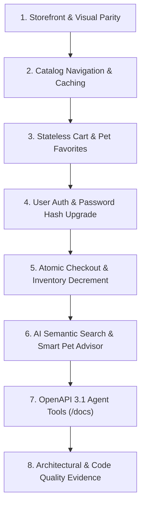

# JPetStore Modernization: Live Demonstration & Evaluation Guide

**Document Version:** 1.1.0  
**Target Reference:** docs/ASSESSMENT.pdf (Evaluation Area: *Demonstration & Engineering Evidence*)  
**Demonstrator:** AI Modernization Lead  
**Application URL:** http://localhost:8080 
**Interactive API Docs (OpenAPI 3.1):** http://localhost:8080/docs

---

## 1. Demonstration Overview

This guide provides a structured, step-by-step walkthrough for evaluating the modernized Python-based JPetStore application. It demonstrates that the modernized platform satisfies all functional and non-functional requirements:
1. **Visual and workflow parity** with the legacy MyBatis JPetStore 6 reference application on the documented flows.
2. **Scale-out readiness** via stateless signed session cookies and an async ASGI runtime (not load tested).
3. **Selective Data Caching** preserving ACID compliance on transactional operations.
4. **AI-Native Innovations** (Semantic Catalog Search, Smart Pet Advisor, OpenAPI 3.1 Autonomous Agent Tool-Calling).

---

## 2. Quick-Start & Verification Prerequisites

* **Running Server:** The application runs via Uvicorn ASGI on port 8080:
  ```bash
  python run.py
  # Server active at: http://localhost:8080
  # Containerized deployment: docker-compose up (active at port 8000)
  ```
* **Demo Test Credentials:**
  * **Username:** `j2ee`
  * **Password:** `j2ee` (auto-upgrades from legacy plaintext to secure `scrypt` hashing upon first login)

---

## 3. Step-by-Step Live Demonstration Script



---

### Step 1: Storefront & Visual Parity
* **Action:** Navigate to http://localhost:8080.
* **Talking Points:**
  * Point out the classic JPetStore branding: 38 graphic assets, navigation banner, animated fish graphic, search bar, and QuickLinks header.
  * Demonstrate the interactive HTML Image Map (`<map name="estore_map">`), which allows clicking directly on pet silhouettes (Birds, Fish, Dogs, Reptiles, Cats).
  * Note that legacy JSPs were converted into clean Jinja2 templates (app/templates/) while preserving the original DOM structure and CSS classes from app/static/css/jpetstore.css.

---

### Step 2: Catalog Navigation & Selective In-Memory Caching
* **Action:**
  1. Click on **Fish** category (or visit `/catalog/categories/FISH`).
  2. Click on **Angelfish** (`FI-SW-01`).
  3. Click on Item **EST-1** (Large Angelfish).
* **Talking Points:**
  * Highlight the 3-tier architecture: app/web/catalog_router.py ➔ app/services/catalog_service.py ➔ app/repositories/catalog_repository.py.
  * Explain **ADR-005 (Selective Data Caching)**: Category and Product metadata are cached in-memory with TTL. Repeat views of the same category and product pages are served from the cache.
  * Point out the real-time inventory count and stock indicator: Inventory is **never cached**, ensuring real-time stock integrity.

---

### Step 3: Stateless Cart & Side-by-Side Pet Favorites Parity
* **Action:**
  1. Click **Add to Cart** on item `EST-1`.
  2. Notice the cart layout: `#Cart` table on the left (69% width) and `#MyList` (Pet Favorites) on the right (30% width) in a side-by-side float, perfectly matching the legacy Java layout.
  3. Change the quantity of `EST-1` to `3` and click **Update Cart**.
  4. Notice the subtotal recalculates instantly using exact `Decimal` arithmetic.
* **Talking Points:**
  * Explain **ADR-004 (Stateless Session Architecture)**: Unlike legacy Spring MVC which stored carts in server-pinned JVM `HttpSession` objects, this modernized cart lives entirely in signed, tamper-evident client session cookies (`itsdangerous` HMAC-SHA256).
  * Any server node behind a load balancer can serve subsequent requests without sticky sessions or session-replication overhead.

---

### Step 4: Account Security & Hash Upgrade
* **Action:**
  1. Click **Sign In** in the top navigation bar.
  2. Enter credentials `j2ee` / `j2ee`.
  3. Click **Login**.
  4. Click **My Account** to show user details, language preferences, and favorite category settings (`favcategory = DOGS`, `mylistopt = 1`).
* **Talking Points:**
  * In legacy JPetStore, passwords were stored in plaintext in the `signon` table.
  * In the modernized platform, the first time user `j2ee` logs in, app/services/account_service.py automatically upgrades their credentials to salted `scrypt` hashes, without disrupting user access (see ADR-006).

---

### Step 5: Multi-Step Checkout Wizard & Atomic Inventory Decrement
* **Action:**
  1. Click **Proceed to Checkout**.
  2. Fill in or accept payment information (Credit Card, Expiration Date, Card Type).
  3. Click **Continue** to review billing and shipping details.
  4. Click **Confirm** to place the order.
  5. The order confirmation page displays the unique Order ID (e.g. `1000` for the first order on a fresh database), Order Date, Line Items, and Status (`P` for Pending).
* **Talking Points:**
  * Highlight the transactional consistency: app/services/order_service.py executes an atomic transaction.
  * Inventory is decremented using atomic row-level SQL checks (`WHERE qty >= :qty`). If stock is exhausted by a concurrent buyer, an `OutOfStockException` is raised, preventing overselling.
  * The order number is generated through atomic sequence incrementing (`sequence.nextid`), matching legacy behavior.

---

### Step 6: AI-Native Innovation — Semantic Natural Language Search & Smart Pet Advisor
* **Action:**
  1. In the search box, type a conversational query instead of a simple keyword:
     * Query: `friendly companion for small apartment`
  2. Click **Search**.
  3. Show the results: Intelligent semantic scoring surfaces gentle dogs and cats (e.g. Bulldog, Poodle, Manx) rather than venomous rattlesnakes or sharks.
  4. In the bottom-right corner of any storefront page, click the floating **🐾 AI Pet Advisor** button to open the interactive drawer.
  5. The drawer automatically analyzes items in the cart via `/advisor/cart_insights` and displays tailored care guidance and accessories.
  6. Type a question into the drawer (e.g. *"What do I feed an adult iguana?"*) to demonstrate real-time contextual responses via `/advisor/chat`.
* **Talking Points:**
  * Explain the design (docs/tokenomics_telemetry_audit.md): search and the advisor use in-process, rule-based semantic scoring over catalog data. They make no LLM calls, so they use no external tokens and have no external dependency. Matching is keyword and concept based, not learned, so unusual phrasing may match less well.

---

### Step 7: OpenAPI 3.1 Autonomous Agent Tool-Calling (`/docs`)
* **Action:**
  1. Navigate to http://localhost:8080/docs.
  2. Expand the **AI Agent Tools (OpenAPI 3.1)** section.
  3. Demonstrate the tool endpoints:
     * `GET /api/v1/tools/search_catalog` (Natural language semantic catalog query)
     * `GET /api/v1/tools/item/{item_id}` (SKU metadata & live stock query)
     * `GET /api/v1/tools/check_stock/{item_id}` (Inventory count check)
     * `POST /api/v1/tools/calculate_order_quote` (Deterministic subtotal/tax/shipping quote)
     * `POST /api/v1/tools/pet_advisor` (Cross-sell accessory & care protocol generator)
  4. Execute **Try it out** on `GET /api/v1/tools/item/EST-1` and show the structured Pydantic response.
* **Talking Points:**
  * Autonomous LLM agents (LangChain, OpenAI Assistants, AutoGen, Claude) can consume these exact endpoints as typed, deterministic tools.

---

### Step 8: Architecture & Engineering Quality Evidence
* **Action:**
  1. Open docs/architecture_decision_records.md to show the 9 ADRs.
  2. Show the automated test suite in tests/ (7 test modules covering database, catalog, cart, account, order, AI tools, and advisor).
  3. Show the CI/CD pipeline in .github/workflows/ci.yml.
  4. Show the production Dockerfile and docker-compose.yml.
* **Talking Points:**
  * Every decision is documented with trade-offs. The codebase achieves strict 3-tier separation, no server-side session store, parameterized queries with a clean Bandit scan, and regression tests across the four domains and the AI endpoints.

---

## 4. Evaluator Q&A Reference Cheatsheet

| Evaluator Question | Recommended Response | Code Reference |
| :--- | :--- | :--- |
| *How is horizontal scalability achieved without a shared session cache like Redis?* | "We transitioned from stateful server-side sessions to cryptographically signed client cookies (`itsdangerous` HMAC-SHA256). Cart items and user auth identifiers are stored in the signed cookie, allowing any server node behind a round-robin load balancer to handle subsequent requests." | app/main.py (session middleware setup) |
| *How do you prevent cache staleness or overselling during high concurrent checkouts?* | "We enforce ADR-005: Read-heavy entities (categories, products) are cached, but transactional entities (`inventory.qty`, `sequence.nextid`) are never cached. Inventory is decremented atomically in the database with row-level checks." | app/services/order_service.py (inventory decrement) |
| *What AI guardrails prevent prompt injection or hallucinated prices?* | "No business logic depends on LLM output, and the search and advisor features make no LLM calls. Calculations are deterministic via Decimal arithmetic. All tool endpoints enforce strict Pydantic v2 schemas and input sanitization bounds." | docs/ai_guardrails_and_verification.md |

---

## 5. Known Limitations

* Sessions are signed but not encrypted cookies, so contents are readable by the client and limited to about 4 KB. Only identifiers and cart references are stored.
* Search and the advisor use rule-based scoring. Phrasing outside the scoring rules may return weaker results than a learned model.
* The demo database is SQLite. PostgreSQL is supported by configuration, but the automated tests run against SQLite.
* No load or latency benchmarking was performed. Scalability statements describe the design, not measured throughput.
* AI usage during the build is recorded as model pool percentage and prompt counts only, because the IDE does not expose token counts (see docs/tokenomics_telemetry_audit.md).
