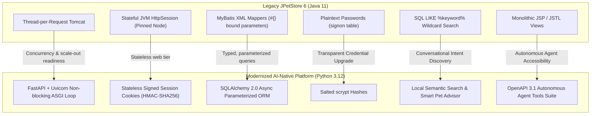

# JPetStore Modernization: System Deviations & Architectural Rationales

**Document Version:** 1.0.0  
**Target Platform:** Python 3.12+ (FastAPI, SQLAlchemy 2.0 Async, Jinja2, Uvicorn)  
**Baseline Reference:** [MyBatis JPetStore 6 (Java 11 / Spring MVC 5.3 / HSQLDB)](https://github.com/mybatis/jpetstore-6)  
**Modernized Codebase:** JPetStore AI-Native Repository  
**Evaluation Standard:** docs/ASSESSMENT.pdf (Architectural Decisions & Trade-offs)

---

## 1. Executive Summary

During the modernization of the legacy **MyBatis JPetStore 6**, our primary objective was **strict functional and visual parity** while resolving critical scalability, security, and architectural bottlenecks present in the 20-year-old reference architecture.

Rather than performing a mechanical syntax translation, deliberate architectural deviations were introduced. Each deviation is grounded in modern cloud-native standards, defensive security practices, and economic AI enablement.

---

## 2. Comprehensive Matrix of Deviations

| # | Domain | Legacy Reference (Java 6) | Modernized Platform (Python) | Primary Rationale & Engineering Trade-Off |
| :-: | :--- | :--- | :--- | :--- |
| **1** | **State & Sessions** | Stateful server-pinned `HttpSession` | Stateless client cookies (`itsdangerous` HMAC-SHA256) | Eliminates sticky session affinity; unlocks instant horizontal scaling behind standard load balancers. |
| **2** | **Runtime & Concurrency** | Synchronous thread-per-request blocking I/O (Tomcat) | Asynchronous non-blocking ASGI event loop (Uvicorn / FastAPI) | Serves many concurrent I/O-bound requests per worker (not load tested). |
| **3** | **Credential Storage** | Plaintext password strings in `signon.password` | Salted `scrypt` hashes (standard library) | Remediates major OWASP vulnerability; transparently auto-upgrades legacy credentials on login. |
| **4** | **Data Access Layer** | MyBatis XML mappers with `#{}` parameter binding | SQLAlchemy 2.0 async parameterized ORM expressions | Parameterization is preserved (the legacy `#{}` bindings were already safe); adds typed queries and static analysis under Mypy and Bandit. |
| **5** | **Presentation Layer** | JSP / JSTL scriptlets and custom tag libraries | Jinja2 templates inheriting modular layout blocks | Maintains visual/CSS parity while removing JVM servlet container dependencies. |
| **6** | **Catalog Caching** | Uncached repetitive SQL hits per page view | In-memory selective LRU/TTL cache (`@lru_cache`, `SearchCache`) | Reduces repetitive catalog queries; strictly excludes transactional tables (`inventory`, `sequence`) to guarantee ACID. |
| **7** | **Search Capability** | SQL `LIKE %keyword%` wildcard matching | Local hybrid semantic scoring & keyword matching | Understands natural language buyer intent (e.g., *"friendly dog for kids"*) with zero external LLM cost. |
| **8** | **Integration Surface** | Server-side rendered HTML only (No API) | Dual Interface: Jinja2 Web UI + OpenAPI 3.1 Agent Tools | Enables autonomous AI agents (LangChain, OpenAI, Claude) to interact with the store via typed Pydantic contracts. |
| **9** | **Assisted Commerce** | None (Static storefront) | Context-aware AI Pet Advisor (app/web/advisor_router.py) | Delivers personalized animal care guidance and cross-sells based on cart category affinities. |
| **10**| **Database Dialect** | Embedded HSQLDB | SQLite (local) / PostgreSQL (production-ready) | Standardized SQL DDL, indexed foreign keys, and multi-threaded connection pooling via async drivers. |
| **11**| **Access Control & Auth Architecture** | Ad-hoc servlet session checks (`session.getAttribute("accountBean")`) | Centralized declarative dependency (`get_current_active_user`) with database liveness checks & session fixation defense | Eliminates boilerplate controller checks, prevents "zombie session" security holes, protects against session fixation, and unifies Web (303 redirect) & API (401 JSON) access control. |

---

## 3. Deep-Dive Architectural Rationales

### 3.1 Deviation 1: Stateless Session Cookies vs JVM `HttpSession`
* **Legacy Behavior:** Legacy `CartBean` and `AccountBean` relied on Spring MVC's session-scoped beans stored in Tomcat memory (`StandardSession`).
* **Why Deviated:**
  1. *Horizontal Scalability:* Server-pinned sessions require sticky load balancers or distributed cache clusters (e.g. Redis/Hazelcast) that add operational fragility.
  2. *Failover Resilience:* If a server node restarts in the legacy design, all active customer carts and login sessions are wiped out.
* **Modern Implementation:** Carts and user identity are serialized into client-side cookies signed with HMAC-SHA256 (configured in app/main.py). Any backend worker can fulfill any request without a server-side session store.

---

### 3.2 Deviation 2: Automatic Password Hash Upgrade vs Plaintext Credentials
* **Legacy Behavior:** Legacy `jpetstore-hsqldb-dataload.sql` stored passwords directly in plaintext (e.g. `'j2ee'`).
* **Why Deviated:** Storing plaintext passwords violates OWASP standards, SOC 2, and basic security hygiene.
* **Modern Implementation:**
  1. app/services/account_service.py hashes passwords with salted `scrypt` from Python's standard library. Argon2id was the original choice (ADR-006), but `argon2-cffi` needed a native build that failed in the target environment (Issue 02), so the standard-library implementation was adopted.
  2. **Zero-Friction Migration:** When legacy users (like `j2ee`) log in with plaintext, the system validates the legacy match and immediately computes and saves a salted hash in the database. No manual user password resets are required.

---

### 3.3 Deviation 3: Selective In-Memory Caching vs Global Caching
* **Legacy Behavior:** Every category click, banner lookup, and product view executed direct queries against the database without in-memory caching.
* **Why Deviated:** In an e-commerce store most traffic is read-only browsing, and repeated queries consume connection pool capacity.
* **Modern Implementation & Guardrail:**
  * **Cached:** Static catalog navigation (`categories`, `bannerdata`, `products`) via app/repositories/catalog_repository.py using bounded, TTL-based in-memory caches.
  * **Strictly Never Cached:** Transactional stock counts (`inventory.qty`) and order sequence counters (`sequence.nextid`). Inventory decrements occur atomically in SQL (`WHERE qty >= :qty`), preventing overselling race conditions under concurrency.

---

### 3.4 Deviation 4: Local Hybrid Semantic Scoring vs External LLM API
* **Legacy Behavior:** Legacy search only returned records where `LOWER(name) LIKE %keyword%`. Searching for *"quiet pet for apartment"* returned 0 matches.
* **Why Deviated:** Modern users expect conversational, intent-based search.
* **Tokenomics Rationale for Local Scoring:**
  * Rather than calling a remote LLM or embedding API per search query, an in-process semantic scoring engine was built in app/services/ai_service.py.
  * **Result:** Intent matching with no external call, so no per-search token cost and no dependency on an external service; catalog data stays in-process. Latency was not formally benchmarked.
  * **Trade-off:** Scoring is keyword and concept based, so unusual phrasing may match less well than a learned model.

---

### 3.5 Deviation 5: OpenAPI 3.1 Autonomous Agent Tool-Calling Suite (`/api/v1/tools`)
* **Legacy Behavior:** Legacy JPetStore was a monolithic HTML rendering application with zero machine-readable APIs.
* **Why Deviated:** Modern ecommerce platforms must support programmatic AI agents, conversational assistants, and headless integrations.
* **Modern Implementation:**
  * Exposes 5 core tools (app/api/v1/tools.py) conforming to the OpenAPI 3.1 tool-calling standard:
    1. `search_catalog` (Conversational product discovery)
    2. `item/{item_id}` (SKU metadata & price inspection)
    3. `check_stock/{item_id}` (Real-time ACID stock query)
    4. `calculate_order_quote` (Deterministic subtotal/tax/shipping calculator)
    5. `advisor_recommendations` (Context-aware pet care advice)
  * All inputs and outputs are strictly constrained by Pydantic v2 schemas, which validate input types and ranges and fix the output shape.

---

### 3.6 Deviation 6: Centralized Declarative Access Control & Session Hardening
* **Legacy Behavior:** Legacy Spring MVC controllers performed scattered, manual checks against `session.getAttribute("accountBean")` inside individual action methods. If unauthenticated, they manually redirected to signon.
* **Why Deviated:**
  1. *Omission Risk & Code Duplication:* Scattered manual `if (!authenticated)` checks in controllers are prone to developer oversight when introducing new routes, creating unauthorized access vulnerabilities.
  2. *Zombie Session Risk in Stateless Cookies:* Pure client-side signed cookies remain technically valid if an account is locked, deleted, or de-provisioned unless verified against the active database state.
  3. *Session Fixation:* Legacy workflows did not regenerate session IDs on successful login, exposing users to session riding if an attacker pre-seeded a session cookie.
* **Modern Implementation:**
  * **Centralized Security Dependency (app/dependencies/auth.py):** Route handlers declare `current_user: Account = Depends(get_current_active_user)`.
  * **Active Database Verification:** The dependency actively verifies that the account exists and is valid in the relational store on each privileged request; deleted/stale accounts cause the session to be purged automatically.
  * **Unified Dual-Plane Handling:**
    * **Web Requests:** Unauthenticated requests raise `NotAuthenticatedException`, intercepted centrally in app/main.py to issue an HTTP 303 redirect to `/account/signonForm`.
    * **REST API Requests:** Requests to `/api/*` raise standard `HTTPException(401, detail="Authentication required")` with RFC-compliant JSON errors.
  * **Session Fixation Defense:** Upon authentication in app/web/account_router.py, the session is cleared (`request.session.clear()`) before binding new identity tokens, while preserving any active anonymous cart contents.

---

## 4. Summary of Parity Preserved

Despite the modern architectural deviations above, **user-facing workflows and visual layouts follow the original; remaining differences are tracked in the issue log**:
1. All 38 original graphic assets (app/static/images/) and CSS styles (app/static/css/jpetstore.css) are reused unchanged.
2. Complete catalog taxonomy (5 categories, 16 products, 28 items) ingested from legacy data files.
3. Multi-step checkout wizard (Cart ➔ Payment ➔ Order Review ➔ Confirmation) preserved with identical fields.
4. Pet Favorites (`#MyList`) side-by-side float alignment matching legacy behavior.
